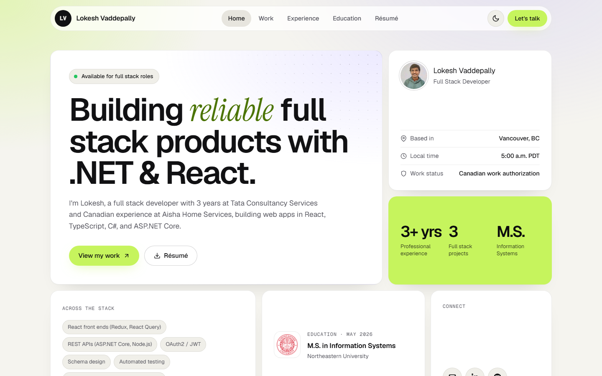
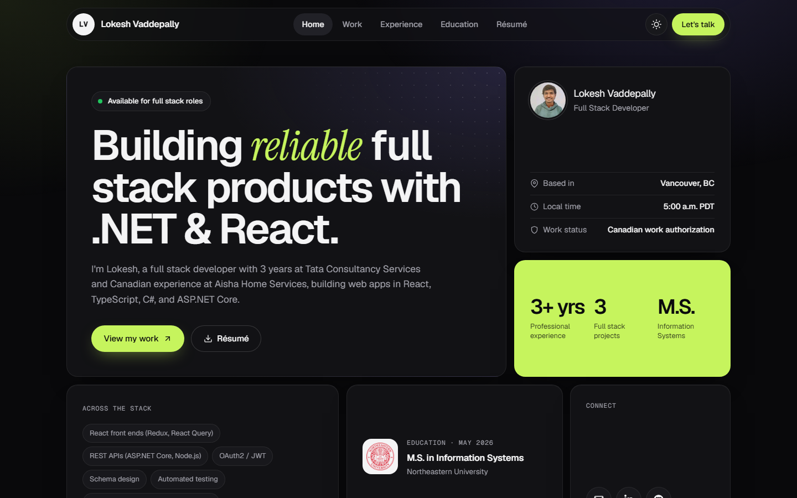

# Lokesh Vaddepally · Portfolio

My personal portfolio site, live at **[lokesh-vaddepally.pages.dev](https://lokesh-vaddepally.pages.dev)**.



<details>
<summary>Dark mode</summary>



</details>

## Features

- **Six pages:** home, projects (full case studies), experience timeline, education and certifications, résumé viewer, and contact.
- **Bento-grid hero** with live Vancouver time, work status and key stats.
- **Light and dark themes** that follow your system setting until you toggle them; the choice is remembered.
- **One content file:** every word on the site comes from `src/data/profile.js`, so updating it doesn't mean touching any components.
- **SEO ready:** canonical URL, Open Graph image, JSON-LD, `robots.txt` and `sitemap.xml`.
- **Scroll-reveal animations** built on `IntersectionObserver`.

## Tech stack

React 18 · React Router 7 · Vite 5 · react-icons · plain CSS with design tokens · Cloudflare Pages

## Run it locally

```bash
git clone https://github.com/LokeshVaddepally77/lokesh-portfolio.git
cd lokesh-portfolio
npm install
npm run dev
```

Then open the URL Vite prints, usually http://localhost:5173.

## Deploy

The site is the `lokesh-vaddepally` project on Cloudflare Pages, deployed by direct upload:

```bash
npm run build
npx wrangler pages deploy dist --project-name lokesh-vaddepally --branch master
```

`dist/` has no `404.html`, so Pages serves `index.html` for unknown paths, and client-side routes like `/projects` work on refresh. If the site URL changes, update it in `index.html` (canonical, Open Graph, JSON-LD), `public/robots.txt` and `public/sitemap.xml`.

## Editing content

| What | Where |
|---|---|
| Summary, skills, experience, projects, education, contact | `src/data/profile.js` |
| Project links (live demo and source) | the `links: { live, github }` object on each project |
| Project card cover | each project's `hue` (tint) and `cover` (`"grid"`, `"code"` or `"list"`) |
| Résumé PDF | `public/Lokesh_Vaddepally_Resume.pdf` (keep the name, or update `resumeFile`) |
| Colors, type and spacing | the tokens at the top of `src/index.css` |

## Project structure

```
src/
  data/profile.js        all site content
  data/techIcons.js      brand icons for the stack marquee
  hooks/useReveal.js     scroll-reveal for [data-reveal]
  hooks/useTheme.js      light/dark toggle, saved in localStorage
  components/            Navbar, Footer, SectionHeader, ProjectCard, ProjectCover
  pages/                 Home, Projects, Experience, Education, Resume, Contact, NotFound
  index.css              the design system
public/                  photo, résumé, certificates, favicon, Open Graph image, SEO files
docs/                    README screenshots
```
